# SwiftUIExperiments

A collection of interactive SwiftUI demos, available from the app's main feature
list. Screenshots below were captured on an iPhone 17 Pro simulator running iOS 26.5.

Each experiment keeps its source and supporting files in a feature folder under
`UI-Experiments/`. The app entry point and main menu remain at the top level.

## Rive Onboarding

  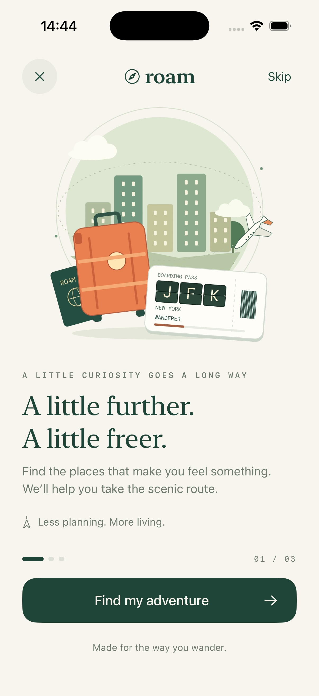
  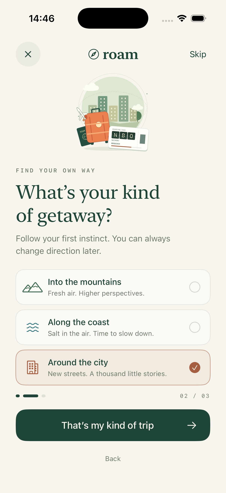
  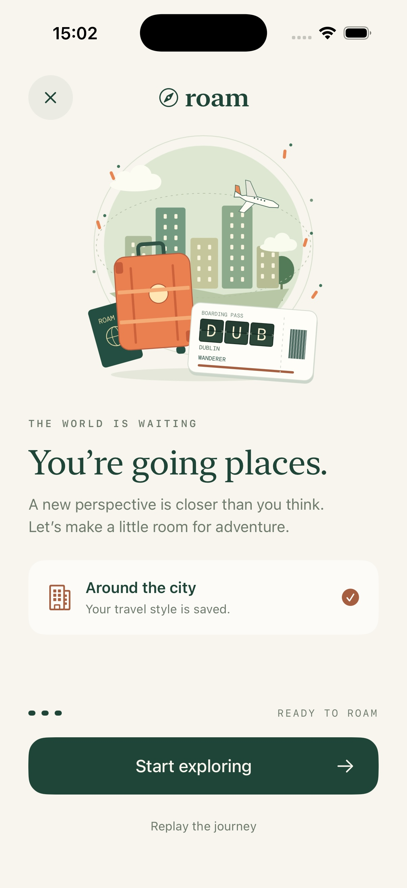

Open **Rive Onboarding** for a three-step travel welcome: discover, choose
mountains/coast/city, then personalize your boarding pass. The Rive illustration
has a floating suitcase, drifting clouds, and a plane circling the globe.
A split-flap boarding pass cycles LHR, JFK, NBO, CPT, and DUB with city captions,
in sync with the plane's orbit. Choosing a travel style blends the scenery;
typing your name updates the pass through Rive data binding. Finishing adds
arrival sparkles and shows the saved travel preference.
Back, Skip, Replay, and locally saved preferences are supported.

[Watch the airport display and plane animation](Resources/Previews/rive-onboarding-airports.mp4).

The official **RiveRuntime 6.28.1** package plays the bundled `.riv` offline.
Reduce Motion holds still poses, background playback pauses, and native controls
support VoiceOver and Dynamic Type. The editable CLI project is in
[`Rive/TravelOnboarding`](Rive/TravelOnboarding); run
`bash scripts/build-rive-onboarding.sh` to verify and rebuild the bundled asset.
See the [feature README](UI-Experiments/RiveOnboarding/README.md) for the binding
contract and integration details.

## X stock graph

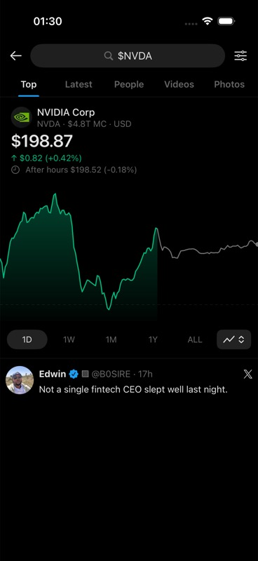

Open **X stock graph** from the main list for an interactive stock card.
The dark search screen includes an NVIDIA quote, green area fill, gray after-hours
line, range pills, floating chart-style menu, and sample post.
The five curves use fixed sample data; this demo does not fetch live market data.
The sample post uses Edwin's supplied photo and **@B0SIRE** handle.

Choose **1D**, **1W**, **1M**, **1Y**, or **ALL** to animate between the curves.
Touch and drag anywhere on the chart to inspect a price: the crosshair follows
the selected point, later prices dim, the quote updates, and a timestamp replaces
the range controls. Releasing restores the current quote. Open the lower-right
menu to select **Line**, **30m**, **1h**, or **4h** candlesticks.

The graph uses native Swift Charts `LineMark`, `AreaMark`, `RuleMark`, `PointMark`,
and `RectangleMark` with `ChartProxy` for touch selection. The 4h weekly candles
use fixed samples; other intervals aggregate the price samples. Range and
style changes provide haptics, Reduce Motion disables transition animations,
and VoiceOver supports adjustable price inspection and a Show latest price action.
The demo supports iOS 17.5 and includes a standalone SwiftUI preview.

## Grok Bot mascots

  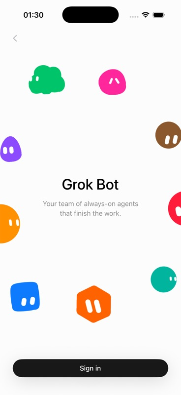
  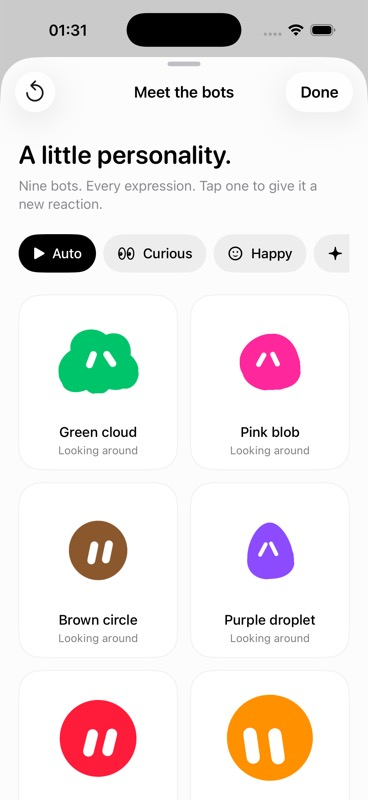

Open **Grok Bot mascots** from the main list for a welcome-screen study.
All nine characters are drawn as native vector paths: green cloud,
pink blob, brown circle, purple droplet, red blob, amber circle, teal circle,
blue rounded square, and orange hexagon. The composition combines slow drift
and body tilts. Each bot has its own random expression sequence, hold durations,
glances, and blink timing. Expressions
blend smoothly and stay consistent across redraws; replay creates fresh sequences.
After the initial drift, the movement returns smoothly and repeats.

Tap a floating bot to cycle through brief happy, surprised, curious, and blinking
reactions. The **Sign in** button opens **Meet the bots**, a local
reaction playground. It does not perform authentication. All nine are visible
in full there; choose Auto, Curious, Happy, Surprised, Sleepy, or Blink for the
whole group, or tap individual cards to change their expressions. Replay
restarts the animations; **Replay welcome** returns to the opening composition.

`GrokBotArtwork` is reusable with a bot, reaction, and time. The animations use
`TimelineView` and `Canvas` with native drawing and no external dependencies.
Reduce Motion holds a still pose while preserving reaction selection, and the
clock pauses when the app is inactive. The demo supports iOS 17.5 and includes
standalone welcome and gallery previews.

## Ultracode

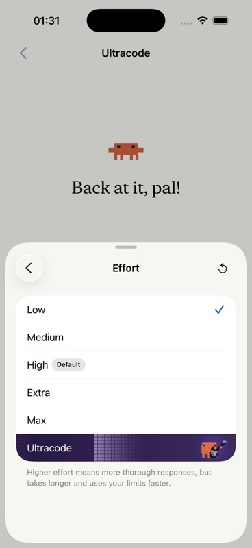

Open **Ultracode** from the main list. The effort modal opens automatically.
Its final row fades from white to aubergine, introduces an orange pixel mascot,
then brings out an electric guitar, floating gold notes, and traveling square-grid
waves. The row animation runs independently of the selected effort.
Tap an effort to select it; the selection survives closing and reopening the
modal. The replay button restarts the entrance sequence.

The guitarist uses separate pixel layers for its body, double-cutaway guitar,
fretting hand, and strumming arm, with stepped playing poses and occasional
blinks. A fixed square lattice lights up in expanding rings from the guitarist;
the first broad wash gives way to shorter pulses and overlapping echoes.

The animation uses SwiftUI `TimelineView` and `Canvas` with procedural pixel art;
no external assets or dependencies are needed. Reduce Motion
shows a still composition, and the timeline pauses while the app is inactive.
The sheet scrolls at larger text sizes and supports the iOS 17.5 deployment target.
[`Ultracode/UltracodeDemoView.swift`](UI-Experiments/Ultracode/UltracodeDemoView.swift)
also includes a standalone preview.

## Dynamic layout

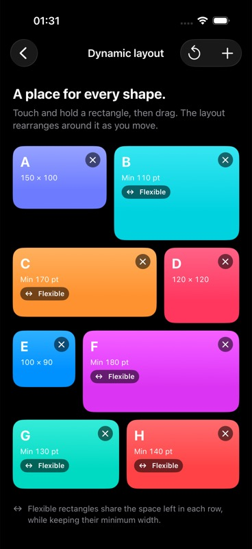

Open **Dynamic layout** from the app's main list. Touch and hold a colored rectangle,
drag to rearrange the layout live, and release to place it. Reset restores the sample order.
VoiceOver users can use the **Move earlier** and **Move later** actions.
Use the **+** toolbar button to add a rectangle with a random color, size, and
fixed or flexible width. Tap its **×** button to remove it. Insertions and removals
animate, and newly added rectangles scroll into view.

- `FlowLayout` measures each child and fills rows in array order. Rows are
  top-aligned and spaced below the tallest child; gaps below shorter children are
  intentionally left empty. Children should respect the proposed width.
- Pass `width: { item in ... }` to `ReorderableFlow` to mix `.fixed(150)` with
  `.flexible(minimum: 110)`. Rows are formed using minimum widths; flexible items
  share any remaining width equally on top of their minimums. Explicit minimums
  are preserved even if the container is narrower. The sample marks flexible
  items with an arrow badge, and recalculates their widths during reordering.
- `ReorderableFlow` accepts a binding to an array of identifiable items and a view
  builder. Replace the sample rectangles with your own components, keeping IDs
  stable. The array updates during the drag. The placeholder and surrounding components
  animate into place while the lifted component follows your finger.
- The sample uses `onDraggingChanged` to pause its surrounding scroll view while
  a rectangle is lifted. Scroll before dragging to reach additional items; this
  sample does not automatically scroll at the viewport edges.

The sample supports the project's iOS 17.5 deployment target and includes a
standalone SwiftUI preview in
[`DynamicLayout/DynamicLayoutDemoView.swift`](UI-Experiments/DynamicLayout/DynamicLayoutDemoView.swift).

## Animated checkbox

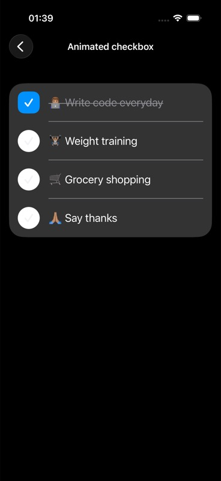

Open **Animated checkbox** from the main list to see all four sample rituals.
Tap a checkbox beside a ritual to toggle its completed state.
Layered shapes animate the checkmark, blue fill, and bounce while the label gains a strikethrough.

## Quiz Page

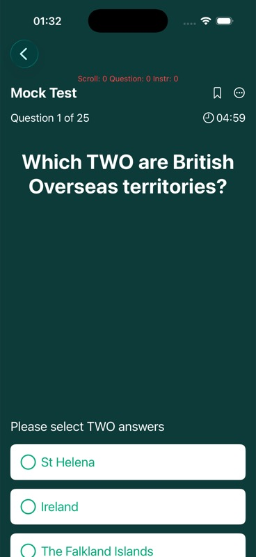

Open **Quiz Page** from the main list for a mock-test screen with a scrolling
question and multiple-choice answers. Select up to two options; tap a selected
option again to clear it.
[`Quiz/StickyHeaderQuestionView.swift`](UI-Experiments/Quiz/StickyHeaderQuestionView.swift) contains the question,
answer selection, and scroll-position tracking for the sticky-header experiment.

## HTML highlighter

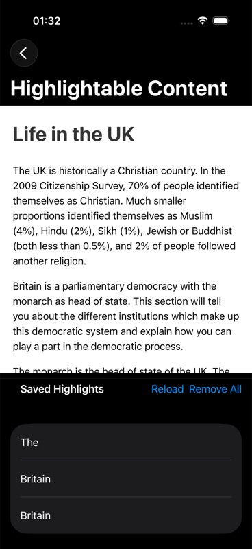

Open **HTML highlighter** from the main list to read the sample **Life in the UK**
HTML page. Select text to add it to **Saved Highlights**. The demo connects a
`WKWebView` to SwiftUI through JavaScript messages and stores highlights locally.
Use **Reload** to read the saved list or **Remove All** to clear it.

## Intensity picker

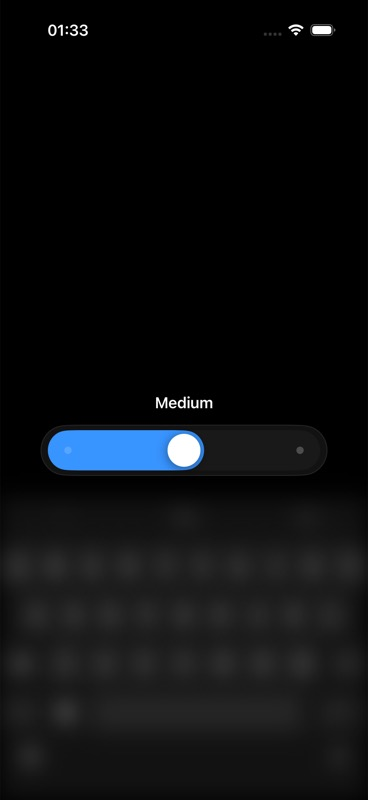

Open **Intensity picker** from the main list, then tap the blue gauge in the
composer. The three-stop slider expands from the composer while the background
blurs and dims. Drag or tap the track to change intensity; releasing snaps the
knob to the nearest stop. Tap outside the panel to dismiss it.

See the [Intensity picker README](UI-Experiments/IntensityPicker/README.md) for
the reusable control, presentation modifier, geometry, and accessibility details.

## Cover Flow

  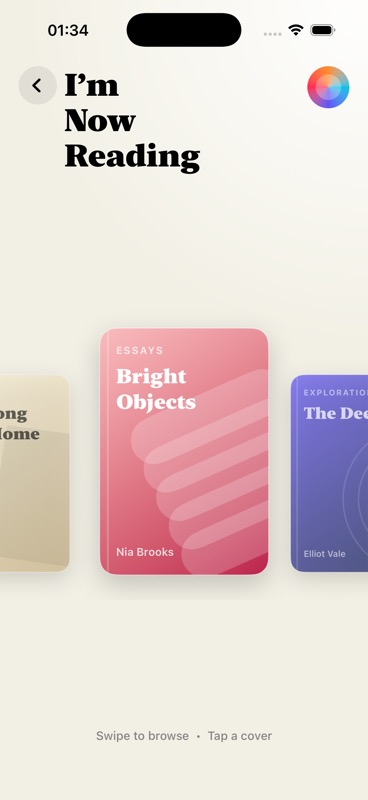
  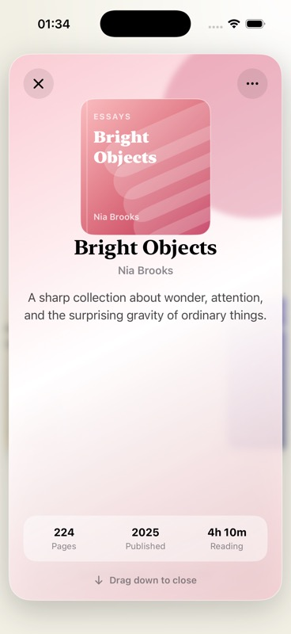

Open **Cover Flow** from the main list. Swipe horizontally to browse the book
covers, then tap a cover to flip and expand it into a detail card. Tap the detail
card to expand it to full screen. Drag down or use the close button to return to
the library. The demo uses sample books, native SwiftUI artwork, and a reduced-motion
transition when Reduce Motion is enabled.
